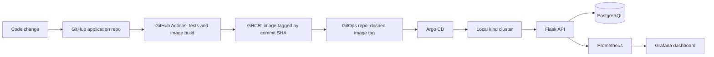
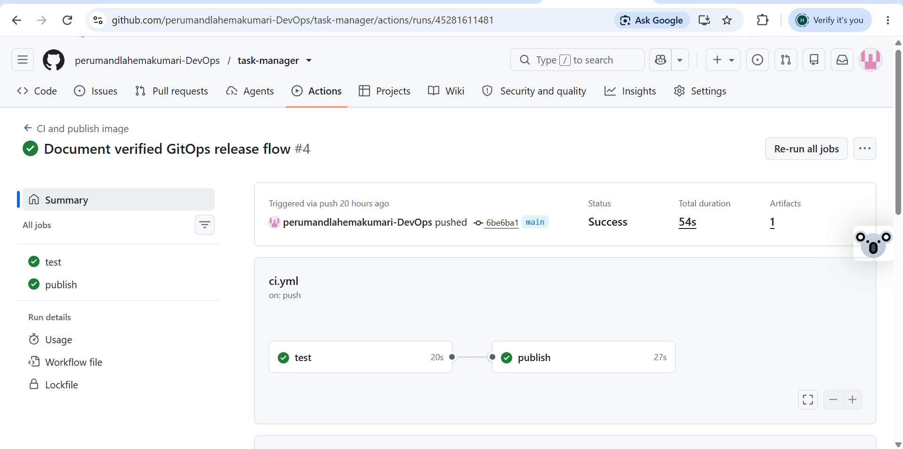
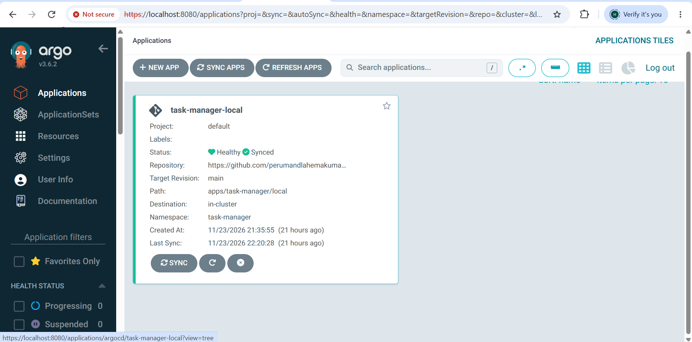
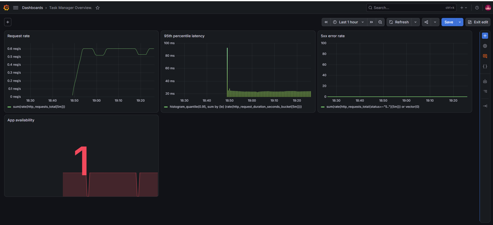

# Task Manager: Local Kubernetes GitOps Portfolio

A Python task management API deployed to a local Kubernetes cluster. This project demonstrates containerisation, CI, GitOps deployment, and application monitoring without using a cloud provider.

## Architecture

- **Web and API tier:** Flask and Gunicorn
- **Application tier:** Python task operations and request handling
- **Data tier:** PostgreSQL
- **Container:** Docker image published to GitHub Container Registry
- **Local Kubernetes:** kind
- **GitOps CD:** Argo CD watches the deployment repository
- **Monitoring:** Prometheus scrapes application metrics; Grafana displays dashboards

## Features

- Create and list tasks
- Update task title or completion state
- Delete tasks
- Health and readiness endpoints
- Prometheus metrics endpoint
- PostgreSQL persistence

## CI/CD and GitOps

1. A feature branch and pull request trigger the CI test job.
2. Merging to `main` builds and publishes a SHA-tagged image to GHCR.
3. The GitOps repository is updated to the new image SHA.
4. Argo CD syncs the GitOps change to the local kind cluster.
5. Prometheus scrapes app metrics, which are displayed in Grafana.

The `0.2.0` release was verified end to end: the API change reached Kubernetes through the SHA-tagged image and GitOps update.

## Monitoring

The application exposes `/metrics`. Prometheus discovers it through a Kubernetes ServiceMonitor. The Grafana dashboard includes request rate, 5xx error rate, latency, and app availability.

## Repositories

- Application and CI: https://github.com/perumandlahemakumari-DevOps/task-manager
- Kubernetes GitOps configuration: https://github.com/perumandlahemakumari-DevOps/task-manager-gitops

## Limitations

This is a learning and portfolio project running locally in kind. It is not a production deployment. PostgreSQL runs as a single replica, and cluster credentials are created locally rather than stored in Git.

## Screenshots

### GitHub Actions

### Argo CD

### Grafana

